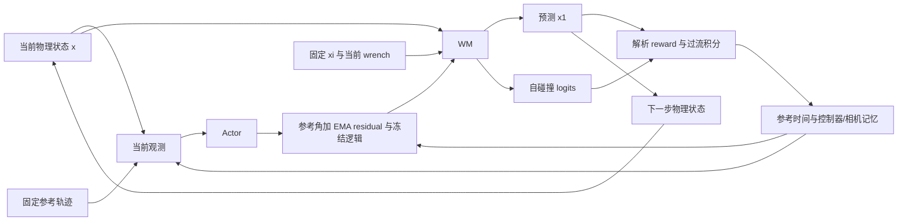

# hand2-pen-spin：WM / Actor / Critic 输入输出、递推关系与 Reward

核对日期：2026-10-26。本文对应当前 `hand2-pen-spin`（Wuji Hand 2 参考轨迹转笔）实现。结构参照 [Hand 1 reorientation 说明](setting_hand1_reorient.md)。`B` 表示 batch size，表格省略 batch 轴。

任务配置：[task.py](../../tasks/pen_spin/task.py)、[env_cfgs.py](../../tasks/pen_spin/config/wuji_hand2/env_cfgs.py)。SuperMimic 适配：[pen.py](pen.py)、[runner.py](runner.py)。运行不依赖 `thirdparty/wuji-mjlab` checkout。

```bash
uv run python -m dex_supermimic.tasks.pen_spin.tooling.download
uv run dex-supermimic-train --task hand2-pen-spin --num-envs 1024 --device cuda:0
```

## 1. 核对结论与实际维度

**WM 返回的下一步物理状态可以继续作为下一次 WM 输入的物理状态。完整闭环还需要参考轨迹、EMA residual、动作冻结、相机记忆、过流积分和外生上下文；这些量由解析逻辑或轨迹读取器维护。**

| 张量 | 维度 |
| --- | ---: |
| Actor 单帧观测 / 实际输入 | **155** |
| Actor 输出：raw action | 20 |
| 物理状态 `x` | 58 |
| 固定仿真上下文 `xi` | **46** |
| 外部 wrench 条件 | **174 = 29×6** |
| WM 的 `dynamics` 参数 | **278 = 58+46+174** |
| WM 实际网络输入：`[dynamics,u]` | **298** |
| WM 原始网络输出：`[delta,contact_logits]` | **67 = 52+15** |
| WM `forward()` 返回 | `(x1:58, contact_logits:15)` |
| Critic 干净任务帧 | 301 |
| Critic 输入（与 wuji-mjlab 相同） | **301** |
| FailureHead privileged context | **368 = 301+20+1+46** |
| Critic 输出 | 1 |
| FailureHead 输入：`[x1,context]` | **426 = 58+368** |
| FailureHead 输出 | 1 logit |
| Replay 中展开的任务/控制器记忆 `m` | 230 |

当前 `xi` 与 Hand 2 reorientation 共用读取逻辑，包含参考任务 6 维 DR 汇总以及逐 actuator Kp/Kd 比例。默认训练主干为 `(2048,2048,2048)`，输入输出维度不受隐藏宽度影响。几何或资源更换后，以运行时日志为准。

本任务仅支持 **50 Hz**：`physics_dt=0.005 s`、`decimation=4`、`control_dt=0.02 s`，每个控制步推进一帧 50 Hz 示范。

## 2. 统一状态、参考轨迹与坐标系

代码：[state.py](state.py)、[sim.py](sim.py) 的 `state()`，以及 [pen.py](pen.py) 的 `PenSimReader`、`PenMDP.reference()`。

```text
x_t = [q(20), qd(20), p(3), R(9), v(3), w(3)]    # 共 58 维
```

| 分量 | 含义与坐标系 |
| --- | --- |
| `q` | 20 个手指关节位置，rad |
| `qd` | 20 个手指关节速度，rad/s |
| `p` | 笔原点相对掌心的位置，掌心系，m |
| `R` | 笔相对掌心的旋转矩阵，按行展开为 9 维 |
| `v` | 笔线速度，用掌心系表达，m/s |
| `w` | 笔角速度，用掌心系表达，rad/s |

物体 free-joint 的角速度先从物体系变换到世界系，再变换到掌心系。掌心固定在支架上。笔的轴向是自身坐标系 **+X**；Actor 和姿态跟踪 reward 使用沿轴的两个点，不观测或奖励绕笔轴的 roll。

### 2.1 参考轨迹

参考命令来自 [commands.py](../../tasks/pen_spin/mdp/commands.py) 的 `SingleHandTrackingCommand`。每帧提供参考关节角、笔在腕/掌心系的 pose，以及 21 个手部 link 在腕/掌心系的位置。21 个 link 为掌心和五指各四个 link。

设当前轨迹在拼接缓冲区的区间为 `[start,end)`，`time` 为轨迹内的控制步索引：

```text
frame_id = min(start + max(time,0), end-1)
reference_t = frames[frame_id]
下一控制步：time ← time+1
```

`time<0` 表示保持第一帧的预备阶段；越过最后一帧时索引停留在 `end-1`，不会读到下一段轨迹。训练使用 RSI 与自适应轨迹片段采样，默认 15% 的 reset 保持第一帧 0.5–3 s；play 从首帧保持 1 s 后开始。

### 2.2 任务与控制器记忆

`PEN_MEMORY_DIMS` 定义 230 维 replay 记忆，主要字段如下：

| 字段 | 维度 | 含义 |
| --- | ---: | --- |
| `c1/c2` | 各 20 | EMA residual 记忆；当前笔任务不使用 `c2` 计算奖励 |
| `a1/a2` | 各 20 | 最近两次 raw action，用于动作平滑 reward |
| `time/start/end` | 各 1 | 参考时间和轨迹边界 |
| `cage` | **20** | 本任务复用此字段名保存逐关节过流积分，不表示笼式越界计数 |
| `limits` | 20 | 当前环境随机化后的 actuator torque 上限 |
| `encoder_bias` | 20 | 每个关节的编码器偏置 |
| `frozen_target` | 20 | 上次实际执行的绝对关节目标 |
| `mask` | 20 | 冻结关节掩码 |
| `mask_remaining/mask_active` | 各 1 | 冻结剩余步数与激活状态 |
| `camera_raw/camera_obs` | 各 6 | 上次新测量和当前实际显示的轴端点 |
| `camera_holding/camera_ticks` | 各 1 | 丢帧保持状态与持续步数 |
| `camera_bias_pos/camera_bias_rot` | 3 / 9 | 本 episode 固定的相机位置/旋转偏置 |
| `age` | 1 | episode 控制步数 |

记忆还保留共用 schema 中的 `goal`、hold/window 等兼容字段；它们不承担转笔目标切换逻辑。笔任务的目标由 `time/start/end` 查参考轨迹获得。

在控制步入口，`m.a1=action_manager.action`，`m.a2=action_manager.prev_action`。**笔任务 Actor 的 `last_action` 使用 `m.a1`**。

## 3. Actor：当前参考与观测 → 残差动作

代码：[networks.py](networks.py) 的 `Actor`、[pen.py](pen.py) 的 `observation()`、`policy_observation()`、`control_target()`。

### 3.1 输入

Actor 与 `thirdparty/wuji-mjlab/src/wuji_mjlab/tasks/pen_spin/pen_spin_env_cfg.py` 的 `policy_terms` 一致，使用单帧 155 维，字段顺序、缩放和训练噪声配置一致，无三帧历史：

| 顺序 | 项 | 维度 | 定义 |
| ---: | --- | ---: | --- |
| 1 | `motion` | 89 | 参考关节角 20 + bounded 参考笔轴端点 6 + 参考 link 位置 63 |
| 2 | `joint_pos` | 20 | `q-q_default`；训练 policy 加 encoder bias 与观测噪声 |
| 3 | `joint_vel` | 20 | `0.25*qd`；训练 policy 加观测噪声，默认关节速度为零 |
| 4 | `object_pose` | 6 | 相机测得的两个笔轴端点，掌心系，使用 tanh 限幅 |
| 5 | `last_action` | 20 | `m.a1` |
| | **合计** | **155** | |

对笔 pose `(p,R)`，两个轴端点与限幅定义为：

```text
P_plus  = p + 0.10 * R[:,0]
P_minus = p - 0.10 * R[:,0]
bounded(P) = 0.15 * tanh(P/0.15)     # 对每个坐标分别计算
```

这里的 ±0.10 m 是观测/奖励的几何标记点，不随物理笔的尺寸随机化变化。默认实物笔总长 0.250 m，训练总长范围为 0.205–0.265 m。

### 3.2 噪声与相机状态

真实环境使用 [observations.py](../../tasks/pen_spin/mdp/observations.py) 的 `ObjectPoseCameraModel`；想象中由 `PenMDP.policy_observation()` 维护一帧延迟与丢帧缓存。

| 项 | 训练配置 |
| --- | --- |
| 关节位置噪声 | 均匀 ±0.015 rad，另加 startup encoder bias |
| 缩放后的关节速度噪声 | 均匀 ±0.05 |
| 相机 episode 位置偏置 | 每轴均匀 ±0.008 m |
| 相机 episode 姿态偏置 | 随机旋转轴，角度均匀 ±0.05 rad |
| 每帧位置 jitter | 每轴均匀 ±0.002 m |
| 每帧姿态 jitter | 随机旋转轴，角度均匀 ±0.015 rad |
| 基础延迟 | 1 个控制步，即 20 ms |
| 进入丢帧保持的概率 | 每步 0.03 |
| 已保持时继续丢帧的概率 | 每步 0.78，最多连续 40 步 |

想象中生成新的带偏置/噪声端点 `raw`；正常时输出上次 `camera_raw`，丢帧时继续输出 `camera_obs`，随后更新缓存。play 使用当前真实 bounded 端点，并关闭 policy 观测噪声。

### 3.3 网络与控制器

```text
RunningNorm(155) → MLP(512,256,128; ELU) → Linear(20) → tanh
输出 a_t: [B,20]，范围 [-1,1]
```

真实采集默认再加入 std=0.1 的高斯探索噪声并截断。想象策略更新直接使用 Actor 输出。

Actor 输出经解析控制器转换为实际 actuator 目标：

```text
residual_raw_t = clamp(0.5*a_t, -0.6, 0.6)
c_t = 0.5*residual_raw_t + 0.5*m_t.c1
u_candidate_t = q_reference_t + c_t - encoder_bias
u_t = where(frozen_dof, previous_executed_target, u_candidate_t)
```

`c_t` 是 **EMA residual**，`u_t` 是 **实际执行的绝对目标**。`control_target()` 返回 `(c_t,u_t)`。此处没有立方体控制器的前 0.4 s default-pose 覆盖，也没有在上述逻辑中按 soft limits clamp 绝对目标。

训练动作冻结的最大触发概率为 0.06，每次选 3 个关节；持续上限从 1 步逐渐增至 5 步，由 `disturbance_success_rate` 课程控制。冻结时继续更新 residual，但执行目标保持不变。WM 的输入及 replay 的 `u` 保存实际执行目标。

## 4. WM：物理状态 + 控制条件 → 下一步物理状态 + 接触

代码：[networks.py](networks.py) 的 `WorldModel`、[sim.py](sim.py) 的 `SimReader.context()` 和 [pen.py](pen.py) 的 `PenObservations.dynamics()`。

### 4.1 输入

```python
dynamics_t = concat(x_t, xi, wrench_t)       # 278
network_input_t = concat(dynamics_t, u_t)   # 298
x1_t, contact_logits_t = wm(x_t, u_t, dynamics_t)
```

`x_t` 作为残差积分基准，同时是 `dynamics` 前 58 维；实际 MLP 没有再重复拼接一次 `x`。

固定仿真上下文 `xi` 按以下顺序展开：

| 字段 | 维度 | 含义 |
| --- | ---: | --- |
| reorient `dr_params` 汇总 | 6 | 由 reorient 观测函数按 cube 模型读取；笔质量/尺寸映射不能按字面解释 |
| `actuator_kp_ratios` | 20 | 当前 Kp / 默认 Kp |
| `actuator_kd_ratios` | 20 | 当前 Kd bias / 默认 Kd bias |
| **合计** | **46** | startup 后读取，rollout 内保留 |

力矩上限单独保存在 `m.limits`，供解析 torque 和过流奖励使用，不拼入 `xi`，也不作为 WM、Critic 或 FailureHead 输入。Critic 同样不读取 `xi`。笔任务当前没有 `joint_damping` DR，该项恒为 0；笔本身的密度/轴向拉伸、接触求解参数、关节摩擦和手部质量/惯量仍未显式输入。

`wrench_t` 为 `robot.data.body_external_wrench` 与 `object.data.body_external_wrench` 展平拼接，合计 29 个 body、每个 6 维，**沿用 entity 数据的原始表达**。它不是立方体任务的 9 维方向/速度扰动缓存。

`auxiliary` 共 195 维：掌心位置 3、掌心旋转 9、兼容占位零向量 9、wrench 174。WM 只取 `auxiliary[:,21:]` 的 wrench 部分。

参考关节角、参考笔 pose、参考 link 位置、过流积分、相机缓存、raw action 历史和 reward 不直接进入 WM。参考关节运动通过实际绝对控制目标 `u_t` 影响动力学。

### 4.2 原始输出与 `forward()` 返回值

默认主干：`RunningNorm(298) → 2048 → 2048 → 2048 → Linear(67)`；每个隐藏层使用 LayerNorm + SiLU，隐藏宽度可配置。

前 52 维为归一化物理增量：

```text
raw_delta = [dq(20), dqd(20), dp(3), dtheta(3), dv(3), dw(3)]
delta = raw_delta * delta_norm.std() + delta_norm.mean

q1 = q+dq                   qd1 = qd+dqd
p1 = p+dp                   R1 = R @ exp_SO3(dtheta)
v1 = v+dv                   w1 = w+dw
x1 = pack(q1,qd1,p1,R1,v1,w1)                # 58 维
```

旋转状态用 9 维矩阵，旋转增量用 3 维旋转向量，所以 delta 为 52 维。`forward()` 返回已经积分的 `x1`。

其余 15 维是手指自碰撞 logits，布局来自 `PenSimReader.contact()`：

| 切片 | 内容 | 维度 |
| --- | --- | ---: |
| `0:10` | 按 finger1–5 顺序，每指 link2、link3 的碰撞标志 | 10 |
| `10:15` | 每指 link4 与 tip_sensor 碰撞标志取 OR | 5 |
| **合计** | | **15** |

真实标签为二值量，想象 reward 使用 `sigmoid(logits)`。这些槽位不是笔与指尖接触标签，也不是唯一碰撞对计数。接触输出不回灌下一次 WM 输入；WM 不直接输出 torque、reward、参考帧或过流积分。

### 4.3 训练监督

默认 `wm_window=8`。窗口起点使用真实状态，随后 open-loop 递推预测状态；逐步控制输入 `u`、动作、residual、wrench 和 post-event `push` 来自 replay。

```text
state_loss_j = mean((difference(predicted_x1_j,true_x1_j)/error_std)^2)
contact_loss_j = sum(BCEWithLogits(contact_logits_j,true_contact_j))
L_WM = sum_batch,time(mask * (1.0*state_loss + 0.1*contact_loss)) / batch_size
```

`error_std=max(delta_norm.std(),error_floor)`，旋转误差通过 SO(3) log 计算。loss 对有效时间步累加后除以窗口 batch 数。默认 `fixed` 模式下归一化统计来自真实、有限的训练环境 transition，held-out 环境不参与更新。

## 5. “这次输出 → 下一次输入”的具体检查

### 5.1 完整递推



对应 `runner.py::policy_update()` 的主要顺序：

```python
# x, m, observation, auxiliary, xi 是步入口状态
context = observations.context(x,m,auxiliary,xi)
a = actor(observation)
c,u = mdp.control_target(a,m,bias)
x1,logits = wm(x,u,observations.dynamics(x,xi,auxiliary[:,21:]))
tau = mdp.pd_torque(x,u,xi,limits=m["limits"])
r,charge,_ = mdp.rewards(x1,m,a,c,sigmoid(logits),tau)
d = mdp.termination(x1,m)
# 当前参考段结束时 d=1；按配置再合并 FailureHead
next_m = advance_memory(x1,m,a,c,charge,next_goal_unused)
next_x = x1                    # pen imagination 的 push 为零
next_auxiliary = auxiliary     # wrench 保持起点值
next_observation = mdp.policy_observation(next_x,next_m,next_auxiliary)
```

`advance_memory()` 执行 `time←time+1`、`c1←c`、`c2←旧c1`、`a1←a`、`a2←旧a1`、`age←age+1`、`cage←charge`。`control_target()` 还维护冻结目标和 mask；`policy_observation()` 维护相机缓存。

因此，下一步 `dynamics[:,:58]` 为本步 WM 返回的 `x1`；下一步控制目标由新参考帧、新动作与更新后的 residual/freeze 状态生成。想象过程中通过保留的帧表查参考，不读取未来真实物理状态。

### 5.2 监督 rollout 与外力

监督 WM 时，每步使用 replay 记录的实际 wrench，并用 `x_next=x1+replay.push` 处理 reward phase 之后的状态修正；`push=next_real_x-captured_physics_x`。当前转笔的 wrench 事件通常改外力缓冲而不直接改物理状态，不能将 wrench 与 velocity push 混为一项。

策略想象期间保持起点 wrench，且不采样立方体任务的速度 push。真实环境仍保留原转笔任务的物体扰动、指尖随机力和课程；当前想象没有复刻完整随机 wrench 的触发、衰减和冷却调度器。

### 5.3 已验证范围与当前边界

本地检查覆盖 2 个 CUDA 环境的小规模采样、WM 更新、actor/critic 反向传播、checkpoint 保存恢复、命令行训练和 headless 回放；另核对了观测重建、参考首尾边界和非几何 reward parity。该检查确认接口可以递推，不证明多步预测精确或策略已经收敛。

当前实现的边界：

1. 完整循环依赖外部保留的参考帧表、`xi`、任务记忆、encoder bias、相机随机量及冻结采样；它们不由 WM 输出。
2. `xi` 包含参考任务 6 维 DR 汇总和逐 actuator Kp/Kd 比例；惯量、接触求解器参数、关节被动参数和力矩上限仍不作为网络输入。物理域随机化仍在真实仿真中生效。
3. MuJoCo reward phase 的 body/site 运动学滞后最终积分状态一个 physics substep；解析 reward 从积分后的状态重建几何。解析 torque 使用控制步入口状态，也不同于真实最后子步实测 actuator force。
4. Critic 沿用 wuji-mjlab 的 301 维干净任务帧，不追加过流积分、参考时间或 `xi`。FailureHead 的 privileged context 追加这些字段，但没有显式加入 wrench、EMA residual、mask、相机状态或距参考结束的剩余步数；两者均不包含完整闭环记忆。
5. FailureHead 的 true replay 分支使用 `x1` 与记录的步入口 `m` 构造 context；predicted 分支和想象分支使用递推后的 memory。参考时间及过流积分存在时序差别，本文记录当前行为，未在本次文档任务中修改代码。
6. 真实 `reference_end` 是 timeout；想象显式令该步 `d=1`，停止后续回报和 bootstrap。该处理与普通 timeout 的 bootstrap 语义存在差别。

## 6. Critic 与 FailureHead

代码：[pen.py](pen.py) 的 `PenObservations.frame/context/critic`、[networks.py](networks.py)、[runner.py](runner.py)。

### 6.1 Critic 输入

Critic 与 `thirdparty/wuji-mjlab/src/wuji_mjlab/tasks/pen_spin/pen_spin_env_cfg.py` 的 `critic_terms` 一致，输入为 301 维干净任务帧，按以下顺序拼接：

| 项 | 维度 | 定义 |
| --- | ---: | --- |
| clean policy 单帧 | 155 | 第 3 节的五项，关节无 bias/noise、笔端点为当前真值 |
| `link_pos` | 63 | 21 个手部 body 原点在掌心系的位置，由可微 FK 计算 |
| `joint_position_error` | 20 | `q-q_reference` |
| `link_position_error` | 63 | 当前 link 位置减参考 link 位置 |
| **合计** | **301** | |

FailureHead 使用的完整 privileged context 与 Critic 输入分开：

```text
context = [task_frame(301), charge(20), time*0.02(1), xi(46)]    # 368
critic_input = context[..., :301]                            # 仅取原版干净任务帧
```

`charge` 是 20 维过流积分；`time*0.02` 为参考时间（秒），预备保持阶段可为负。这三项额外信息只提供给 FailureHead，不进入 Critic。Critic 没有多帧历史。

```text
RunningNorm(301) → MLP(512,256,128; ELU) → Linear(1)
返回 V(s_t): [B]，无 tanh 或 sigmoid
```

默认 `gamma=0.99`、`lambda=0.95`、`critic_epochs=5`、`critic_minibatches=4`：

```text
G_H = V(s_H)
G_t = r_t + gamma*continue_t*((1-lambda)*V(s_{t+1}) + lambda*G_{t+1})
L_critic = mean((V(s_t)-stop_gradient(G_t))^2)
```

Actor 最大化折扣、存活加权的想象收益，在 horizon 末用 Critic bootstrap。Actor 更新期间冻结 WM、Critic、FailureHead 参数，但保留输入到动作的梯度。

本次输入对齐后，旧版 privileged checkpoint 不能直接完整恢复到新的 368 维 FailureHead context，需重新训练或显式迁移权重。

### 6.2 FailureHead

```text
features = [x1(58), context(368)]             # 426
RunningNorm(426) → MLP(256,128; ELU) → Linear(1)
sigmoid(output) = learned physical-failure probability
```

监督标签为 replay 的 `terminated`，不包括 timeout；NaN/非有限 transition 通过 valid mask 排除。默认在 `wm_only_iters+failure_warmup_iters=500+300` 轮后参与想象：

```text
p_fail = min(sigmoid(logit),0.1)
d = 1-(1-d_analytic)*(1-p_fail)
continue = 1-d
```

参考结束时已将 `d_analytic` 置为 1。`--no-failure-head` 关闭 learned failure 对想象终止的贡献，保留解析终止。

## 7. Reward 的设计和公式

真实配置：[env_cfgs.py](../../tasks/pen_spin/config/wuji_hand2/env_cfgs.py)；真实 reward：[rewards.py](../../tasks/pen_spin/mdp/rewards.py)；想象重建：[pen.py](pen.py) 的 `PenMDP.rewards()`。

### 7.1 总体定义

```text
r_t = 0.02 * sum(下面各项加权 reward)
```

表中公式包含权重，尚未乘 `dt=0.02`。`q/p/R/link` 来自本步 `x1`；参考来自**步入口的当前帧**；`a` 为本步 raw action，`m.a1/m.a2` 是旧动作。先计算 reward，再推进参考时间。

定义 `P` 为第 3 节的两个未限幅轴端点，`L_i` 为 21 个 link 位置，`range_j=upper_j-lower_j` 为真实关节位置范围：

| 名称 | 加权公式 | 设计目的 |
| --- | --- | --- |
| `object_pos` | `2*exp(-(norm(p-p_ref)/0.05)^2)` | 跟踪笔中心位置 |
| `object_rot` | `8*exp(-(mean_i(norm(P_i-P_ref_i))/0.04)^2)` | 跟踪两端点，联合约束位置与轴方向；忽略轴向 roll |
| `link_pos` | `mean_i(exp(-(norm(L_i-L_ref_i)/0.025)^2))` | 跟踪参考手指姿态 |
| `joint_pos` | `mean_j(exp(-((abs(q_j-q_ref_j)/range_j)/0.1)^2))` | 以关节活动范围归一化关节跟踪误差 |
| `action_rate` | `-0.1*sum((a-m.a1)^2+(a-2*m.a1+m.a2)^2)` | 抑制 raw action 一阶和二阶变化 |
| `torque` | `-sum((tau/nominal_limit)^2)` | 惩罚相对标称力矩上限的负载 |
| `overcurrent` | `-4*sum(max(charge_next-0.8,0))/0.2` | 惩罚持续高电流负载 |
| `finger_collision` | `-sum(contact_15_slots)` | 惩罚手指自碰撞，合并 distal 与 tip_sensor |

`object_rot` 使用未经过 tanh 的端点；Actor 和 motion 观测使用 bounded 端点。两个端点的误差包含平移，因此此 reward 不只是一个纯角度误差函数。

### 7.2 Torque 与过流积分

想象中的 torque 由步入口 `x_t`、本步实际绝对目标 `u_t` 和当前环境参数解析计算：

```text
Kp = default_Kp * xi.Kp_ratio
Kd_bias = default_biasprm_2 * xi.Kd_ratio     # 负数，相当于 -Kd
limit = m.limits                           # 当前环境随机化上限，仅用于解析 torque/reward

tau = clamp(Kp*(u-q)+Kd_bias*qd, -limit, limit)
```

当前 Hand 2 actuator 的 gear 为 1。真实 reward 使用 MuJoCo 实测 actuator force。

`torque` 项始终除以编译模型的**标称**力矩上限；过流积分的 load 使用**当前环境随机化后**的上限：

```text
load = min(abs(tau)/limit,1)
charge_next = clamp(charge + 0.02*(load/1.0-charge/2.0),0,1)
overcurrent = -4*sum(max(charge_next-0.8,0))/0.2
```

因此短暂高负载不会立即触发过流惩罚；积分超过 0.8 后开始扣分。`charge_s=1 s`、`leak_s=2 s`，每个关节独立维护。

### 7.3 解析终止与参考结束

真实训练终止包括数值不稳定、位置误差超过 0.05 m、轴方向误差达到 60°；另有 episode timeout 和 `reference_end` timeout。play 移除位置/轴向误差提前终止。

想象中使用 soft 位置和轴向判定：

```text
e_pos = norm(p-p_ref)
cosine = dot(R[:,0],R_ref[:,0])
d_pos = sigmoid((e_pos-0.05)/0.002)
d_axis = sigmoid((0.5-cosine)/0.02)           # cos(60°)=0.5
d_analytic = 1-(1-d_pos)*(1-d_axis)

if time+1 >= end-start:
    d_analytic = 1
```

随后按第 6 节合并 FailureHead。终止影响存活权重和 value bootstrap，不额外添加某个固定掉笔 reward。

## 8. 数据、启动与复现检查

五组共 40 段示范分别为：

| 配方 | 轨迹数 |
| --- | ---: |
| `01_single_axis` | 10 |
| `02_continuous_single_axis` | 4 |
| `03_continuous_multi_axis`（默认） | 9 |
| `04_stable_grasp_rotation` | 10 |
| `05_multi_axis_two_rotations` | 7 |

本机已下载并通过各组 SHA-256 校验；新 checkout 使用本文开头的 download 命令。数据不随源码/wheel 打包，可通过 `--clips-root /path/to/clips` 指定外部目录。

切换配方：

```bash
uv run dex-supermimic-train --task hand2-pen-spin \
  --recipe-path src/dex_supermimic/tasks/pen_spin/data/recipe/01_single_axis.json \
  --num-envs 1024 --device cuda:0
```

日志目录为 `logs/dex_supermimic/hand2-pen-spin/<timestamp>/`，保存环境配置、输入布局、context 布局和 checkpoint。checkpoint 校验任务、频率、关节顺序、context 布局及参考数据指纹。

```bash
uv run dex-supermimic-play --checkpoint logs/dex_supermimic/hand2-pen-spin/<run>/model_final.pt
# 无窗口短回放
uv run dex-supermimic-play --checkpoint <checkpoint.pt> --no-viser --steps 500
```

回放从 checkpoint 读取任务与配方，可以覆盖 `--clips-root` 迁移数据路径。Pen spin 使用标准 mjlab Viser viewer 查看策略及参考动作，目前没有立方体任务的 WM 重影。ONNX 导出沿用 `--export-onnx policy.onnx`，配套元数据描述参考角加 EMA residual 的控制接口。

回归检查：

```bash
MUJOCO_GL=egl uv run python -m unittest discover -s tests/dex_supermimic -v
```

当前已有 7 项测试通过，包括两种手的 reorientation 回归与 pen-spin 配置、数据、观测/奖励核对和训练恢复检查。尚未完成长期训练或确认收敛后的转笔成功率。
