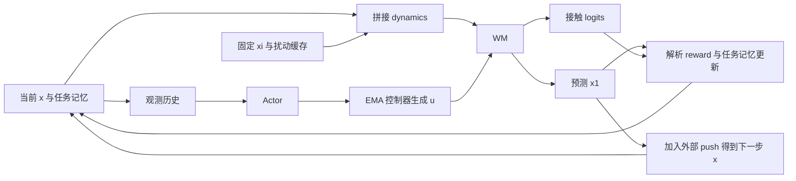

# hand2-reorient：WM / Actor / Critic 输入输出、递推关系与 Reward

核对日期：2026-10-26。本文仅对应当前 `hand2-reorient`（Wuji Hand 2 方块翻转）实现，不以旧实验配置为准。`B` 表示 batch size，省略表格中的 batch 轴。

任务配置：[env_cfgs.py](../../tasks/dex_reorient/config/wuji_hand2/env_cfgs.py)、[task.py](../../tasks/dex_reorient/config/wuji_hand2/task.py)。

```bash
uv run dex-supermimic-train --task hand2-reorient --num-envs 1024 --device cuda:0
```

## 1. 核对结论与实际维度

**目前可以递推运行：WM 返回的下一步物理状态可以作为下一次 WM 输入中的物理状态。完整闭环由 WM、Actor、解析控制器、任务状态机和外生上下文共同组成。WM 单独的原始网络输出不能直接原封不动地作为下一次完整网络输入。**

| 张量 | 维度 |
| --- | ---: |
| Actor 单帧观测 | 69 |
| Actor 输入：3 帧历史 | 207 |
| Actor 输出：raw action | 20 |
| 物理状态 `x` | 58 |
| 固定仿真上下文 `xi` | 46 |
| 外部扰动缓存 | 9 |
| WM 的 `dynamics` 参数 | 113 |
| WM 实际网络输入：`[dynamics, u]` | **133** |
| WM 原始网络输出：`[delta, contact_logits]` | **84 = 52 + 32** |
| WM `forward()` 返回 | `(x1:58, contact_logits:32)` |
| Critic 输入：`[三帧 task_frame, xi]` | **541 = 165 × 3 + 46** |
| Critic 输出 | 1 |

这些维度已用当前资源实际构建环境并核对。两个 reorientation 手型的 WM 维度相同，但接触维度和 geom 资源不同；更换碰撞几何后，以运行时网络及日志 `input_layout.json`、`context.json` 为准。接触维度来自 `SimReader.contact().shape[-1]`。

## 2. 统一状态与坐标系

代码：[state.py](state.py)、[sim.py](sim.py)。

```text
x_t = [q(20), qd(20), p(3), R(9), v(3), w(3)]     # 共 58 维
```

| 分量 | 含义与坐标系 |
|---|---|
| `q` | 20 个关节位置，rad |
| `qd` | 20 个关节速度，rad/s |
| `p` | 方块原点相对掌心的位置，掌心系，m |
| `R` | 方块相对掌心的旋转矩阵，按行展开为 9 维 |
| `v` | 方块线速度，用掌心系表达，m/s |
| `w` | 方块角速度，用掌心系表达，rad/s |

`SimReader.state()` 从实际 `qpos/qvel` 读取状态，并转换坐标系；物体 free-joint 的角速度先从物体系转换到世界系，再转换到掌心系。固定掌心下，这些速度可直接用于当前动力学表示。

任务与控制器记忆 `m` 单独保存，不要求 WM 学习预测：

- `c1/c2`：最近两次 EMA 控制目标；`a1/a2`：最近两次 raw action；每项 20 维。
- `goal`：掌心系目标旋转矩阵，9 维。
- `hold`、`goal_timer`、`window`、`window_timer`、`reward_window`、`reward_hold`、`reward_snapshot`、`within`：目标保持和切换状态。
- `cage`：笼式越界计数；`age`：episode 控制步数；`count`：目标达成次数。

注意动作历史的代码定义：在控制步入口，`m.a1 = action_manager.action`，`m.a2 = action_manager.prev_action`；Actor 单帧观测使用的是 **`m.a2`**。不要在重写观测时直接替换成 `m.a1`。

## 3. Actor：观测历史 → 动作

代码：[networks.py](networks.py) 的 `Actor`；[mdp.py](mdp.py) 的 `observation/flatten_history/noisy_observation`。

### 3.1 输入

单帧 `o_t` 为 69 维：

| 顺序 | 项 | 维度 | 定义 |
|---:|---|---:|---|
| 1 | `joint_angles` | 20 | 按 soft joint limits 中心和半幅归一化的关节位置，截断到 `[-1,1]` |
| 2 | `qpos_error` | 20 | 归一化关节位置减归一化 EMA 目标 `m.c1` |
| 3 | `cube_pos_in_tag` | 3 | 方块在 wrist tag 坐标系的位置 |
| 4 | `cube_ori_error` | 6 | tag 系方块相对目标的误差旋转矩阵后两行 |
| 5 | `action_history` | 20 | `m.a2`，按上面的代码时序定义 |

Actor 输入为每项各自堆叠 3 帧后的 207 维：

```text
[q 三帧(60), qpos_error 三帧(60), p 三帧(9), orientation 三帧(18), action 三帧(60)]
```

**不是**直接把三个完整 69 维向量逐帧拼接。`history_from_obs()` 和 `flatten_history()` 负责互相转换。

训练采集使用环境带噪观测；想象中由预测状态和递推记忆生成观测，再注入噪声并移动历史窗口。噪声包括关节均匀噪声 ±0.06、位置均匀噪声 ±0.008 m、姿态 6D 的高斯噪声 std=0.05，以及位置和姿态各 2% 的异常值注入。play 配置关闭环境 policy 观测噪声。

### 3.2 网络与输出

```text
RunningNorm(207) → MLP(512,256,128; ELU) → Linear(20) → tanh
输出 a_t: [B,20]，范围 [-1,1]
```

真实采集默认加入 std=0.1 的高斯探索噪声并截断；想象策略更新直接使用 Actor 输出。

Actor 的 `a_t` 经过解析控制器才成为 WM 的控制输入：

```text
raw_t = clamp(q_default + 0.5 * clamp(a_t,-1,1), soft_lower, soft_upper)
c_t   = alpha * raw_t + (1-alpha) * m_t.c1
前 0.4 s：c_t = q_default
u_t   = c_t - encoder_bias
```

50 Hz：`alpha=0.3`；20 Hz：`alpha=0.5`。`c_t` 是偏置修正前的 EMA 目标，`u_t` 是实际 actuator 位置目标。WM 接收 `u_t`，不直接接收 raw action。

## 4. WM：物理状态 + 控制条件 → 下一步物理状态 + 接触

代码：[networks.py](networks.py) 的 `WorldModel`、[observations.py](observations.py) 的 `dynamics()`。

### 4.1 输入

```python
dynamics_t = concat(x_t, xi, disturbance_t)
network_input_t = concat(dynamics_t, u_t)
x1_t, contact_logits_t = wm(x_t, u_t, dynamics_t)
```

`x_t` 同时作为 `forward()` 的残差积分基准和 `dynamics_t` 的前 58 维；它没有在实际 MLP 输入中重复拼接两次。

| 输入项 | 维度 | 来源 |
| --- | ---: | --- |
| 当前物理状态 `x_t` | 58 | 首步读真实状态，后续读预测状态 |
| wuji-mjlab `dr_params` | 6 | `[摩擦, 物体质量, Kp, Kd, 关节 damping, 物体尺寸]` 的均值比例，顺序与原 critic 完全一致 |
| 20 个 actuator 的 Kp 比率 | 20 | 当前值 / 默认值 |
| 20 个 actuator 的 Kd 比率 | 20 | 当前值 / 默认值；MuJoCo bias 中保留负号 |
| 扰动缓存 | 9 | `[方向3, 最近一次线/角速度扰动6]` |
| actuator 目标 `u_t` | 20 | Actor + EMA 控制器 |
| **合计** | **133** |  |

`xi` 是参考任务 6 维 DR 汇总和逐 actuator Kp/Kd 比率的合并表示，在 rollout 内保留；不是每步由 WM 重新预测。缓存描述最近一次扰动事件，**不是尚未发生的下一次扰动的预知输入**。

目标姿态、保持计数、episode age、cage counter、动作历史、reward、Critic task frame 不进入 WM 的动力学网络。

### 4.2 原始输出与 `forward()` 返回值

默认主干：`RunningNorm → 2048 → 2048 → 2048 → 输出`，每个隐藏层使用 LayerNorm + SiLU。隐藏宽度可配置。

原始输出前 52 维是归一化物理增量：

```text
raw_delta = [dq(20), dqd(20), dp(3), dtheta(3), dv(3), dw(3)]
delta = raw_delta * delta_norm.std() + delta_norm.mean
```

随后 `integrate()` 计算：

```text
q1 = q + dq                  qd1 = qd + dqd
p1 = p + dp                  R1 = R @ exp_SO3(dtheta)
v1 = v + dv                  w1 = w + dw
x1 = pack(q1, qd1, p1, R1, v1, w1)              # 58 维
```

因此，**52 维增量和 58 维状态维度不同是有意设计**：旋转增量使用 3 维旋转向量，而旋转状态使用 9 维矩阵。`forward()` 返回的是积分后的 `x1`，不需要调用者再次积分。

其余原始输出为接触 logits：

| 切片 | 内容 | 维度 |
| --- | --- | ---: |
| `0:5` | 五个指尖与方块接触 | 5 |
| `5:6` | 掌心或近端指节与方块接触 | 1 |
| `6:7` | 远端指节与方块接触 | 1 |
| `7:` | 手指自碰撞传感器槽位 | 25 |
| 合计 |  | 32 |

接触标签是二值量；想象 reward 使用 `sigmoid(logits)`。接触输出用于该步 reward，不作为下一步 WM 的历史输入。WM 不输出 torque、reward 或任务计数。

### 4.3 训练监督

默认 `wm_window=8`。只从窗口起点读取真实 `x`，之后连续递推预测状态；每步控制目标 `u` 和外部 push 来自 replay。

```text
state_loss_j = mean((difference(predicted_x1_j, true_x1_j) / error_std)^2)
contact_loss_j = sum(BCEWithLogits(predicted_contact_j, true_contact_j))
L_WM = sum_over_batch_and_time(mask * (1.0*state_loss + 0.1*contact_loss)) / batch_size
```

`error_std = max(delta_norm.std(), error_floor)`；旋转误差通过 SO(3) log 计算。这里对有效时间步累加后除以窗口 batch 数，并非除以所有有效时间步数。

## 5. “这次输出 → 下一次输入”的具体检查

### 5.1 完整递推



对应 `runner.py::policy_update()` 的顺序：

```python
# x, m, history, auxiliary, xi 是本步入口状态
actor_input = flatten_history(history)
a = actor(actor_input)
c, u = ema_target(a, m['c1'], ..., bias, alpha, m['age'], dt)
dynamics = observations.dynamics(x, xi, auxiliary[:, 12:21])
x1, contact_logits = wm(x, u, dynamics)
tau = mdp.pd_torque(x, u, xi)
r, cage, _ = mdp.rewards(x1, m, a, c, sigmoid(contact_logits), tau, soft=True)
next_m = advance_memory(x1, m, a, c, cage, sampled_next_goal)
# 本步 reward 和 failure 计算完成后，处理外部速度扰动
next_auxiliary = advance_disturbance(auxiliary, event, world_dir, world_dv)
next_x = x1 + push
next_history = append(history, noisy_observation(observation(next_x, next_m)))
# 下一轮：
next_dynamics = observations.dynamics(next_x, xi, next_auxiliary[:, 12:21])
```

其中 `push` 为 58 维修正，想象中只有物体线速度对应的 3 维非零。无扰动时，`next_dynamics[:,:58]` 就是本次 WM 返回的 `x1`；有扰动时是 `x1 + push`。下一步 `u` 由下一次 Actor 输出及更新后的控制记忆生成。

`advance_memory()` 更新 `c2←旧c1`、`c1←c`、`a2←旧a1`、`a1←a`、`age←age+1`，并从预测状态递推目标状态机和 cage counter。后续观测与 Critic 特征均重新计算，不从真实仿真器读取后续物理状态。

### 5.2 实际确认与适用范围

本次为 `hand2-reorient` 构建 2 个 CUDA 环境，从真实初始状态出发，使用小型 WM 连续递推 **3 步**，验证了：

- 每步 `x1` 保持 `[2,58]`，接触输出为 `[2,32]`。
- 无 push 时，下一步 `dynamics` 前 58 维与上一步 `x1` 逐元素相等。
- 更新控制记忆和观测历史后，Actor 继续接受 `[2,207]` 并输出 `[2,20]`。
- Critic 接受 541 维特征，输出 `[2]`；状态、reward、value 均有限。

该检查确认了**接口与计算图能够递推**，并不证明多步预测误差小或已经具备精确的 Markov 动力学。当前实现还有以下边界：

1. 完整循环依赖保留的 `xi`、encoder bias、任务记忆、掌心位姿、DR 辅助量，以及外部目标和扰动事件的生成。它们不是 WM 输出。
2. `xi` 只含摩擦和 Kp/Kd 比率，未显式包含全部 startup 随机量，例如物体质量/尺寸、COM、关节 armature、手部质量/惯量、接触求解参数。因此当前 WM 是有限条件下的近似动力学模型；同一输入未必唯一决定所有随机化环境的真实转移。
3. 仿真奖励阶段的 body/site 派生量滞后最终积分状态一个 physics substep，而 WM 预测目标是积分后的 `qpos/qvel`。几何 reward 重建不能声称逐项完全一致；解析 torque 从控制步入口估计，也不等同于多子步控制中最后一次实测 actuator force。
4. `fit_world_model()` 从 replay 的掌心系速度 `push` 重建扰动缓存时，当前直接把它作为 `world_velocity/world_direction` 传给 `advance_disturbance()`，未转回世界系；真实缓存和想象采样路径使用世界系。这是现有坐标系不一致，本文记录，未在本次文档任务中修改代码。
5. 真实扰动按 0.6–1.8 s 的 interval 调度；想象用每步 `dt/1.2` 的 Bernoulli 事件近似，分布并不完全相同。真实新目标与想象新目标都依赖外生采样，而非 WM 预测。

因此，对“能否实现这次输出是下一次输入”的回答是：**物理状态部分可以；完整输入通过解析更新和外生条件补齐后可以。若要求 WM 自身输出所有输入字段、且无需任何保留状态或外部事件，目前不满足这一更强要求。**

## 6. Critic：三帧历史 → 状态价值

代码：[observations.py](observations.py) 的 `frame/context/critic`、[networks.py](networks.py) 的 `Critic`。

Critic 使用与 PPO 相同的三帧历史：每个 task term 按时间展开后拼接，再附加固定的 `xi`，共 `165 × 3 + 46 = 541` 维。真实采样保存环境的 critic 历史（包含环境 reset 的填充语义），想象 rollout 每步移入递推得到的 clean task frame。WM 与 FailureHead 仍只使用当前帧 context。

| task frame 项 | 维度 | 说明 |
|---|---:|---|
| clean policy 单帧 | 69 | 第 3 节的五项，不加观测噪声 |
| `true_joint_pos` | 20 | `q - default_q` |
| `true_joint_vel` | 20 | `qd - default_qd` |
| `fingertip_positions` | 15 | 五个 distal **body 原点**世界位置减 env origin 和 `(0,0,0.5)` 后乘 5；不同于 reward 中的 tip site |
| clean 方块位置与姿态误差 | 9 | policy 中 3+6 项的再次拼接 |
| 方块线速度、角速度 | 6 | 将物理状态中的掌心系速度转到**世界系** |
| 扰动方向与速度缓存 | 9 | 世界系缓存 |
| `state_progress` | 4 | hold/hold_steps、reward_window/switch_steps、age/max_episode_length、count |
| `cage_counter` | 1 | `min(cage/max_outside,1)` |
| `dr_params` | 6 | 依次为摩擦、物体质量、Kp、Kd、关节 damping、物体尺寸的均值比例 |
| `palm_rot_6d` | 6 | 掌心世界旋转矩阵后两行 |
| **合计** | **165** | |

当前 `dr_params` 与原环境 critic 的 6 维定义和顺序完全一致。注意这 6 个标量也会出现在 `xi` 开头；`xi` 随后仍保留逐关节 Kp/Kd 比例，用于解析 torque 和提供更细粒度的仿真上下文。

```text
RunningNorm(541) → MLP(512,512,256,128; ELU) → Linear(1)
返回 V(s_t): [B]；无 tanh、sigmoid，也不是 Q(s,a)。
```

Critic 回归想象轨迹上的 λ-return。当前默认 `gamma=0.99`、`lambda=0.95`、`critic_epochs=5`、`critic_minibatches=4`：

```text
G_H = V(s_H)
G_t = r_t + gamma * continue_t * ((1-lambda)*V(s_{t+1}) + lambda*G_{t+1})
L_critic = mean((V(s_t) - stop_gradient(G_t))^2)
```

Actor 最小化负的折扣存活加权想象收益，并在 horizon 末尾用 Critic bootstrap。更新 Actor 时冻结 WM、Critic、FailureHead 的参数，但保留通过这些网络输入传播到动作的梯度。

## 7. Reward 的设计和公式

真实环境配置：[reorient_terms.py](../../tasks/dex_reorient/reorient_terms.py)、[recipe.py](../../tasks/dex_reorient/config/recipe.py)；真实 reward：[rewards.py](../../tasks/dex_reorient/mdp/rewards.py)、[cage.py](../../tasks/dex_reorient/mdp/cage.py)；想象中的可微重建：[mdp.py](mdp.py) 的 `rewards()`。

### 7.1 总体定义

```text
r_t = dt * sum(下面各项加权后的 reward)，dt = 1 / control_hz
```

表中公式**已经包含权重，尚未乘 dt**。状态 `q/qd/p/R/v` 使用本步预测的 `x1`；`a` 为本步 raw action，`c` 为本步 EMA 目标；记忆 `m` 为步入口记忆。真实 reward 用实际传感器和 actuator force；想象用接触概率和解析 torque。

| 名称 | 加权公式 | 设计目的 |
|---|---|---|
| `orientation_alignment` | `15 * max(1 - max(theta-0.2,0)/pi, 0)` | 将方块转向目标；角误差 ≤0.2 rad 时达到最大值 |
| `hand_pose` | `-0.2 * sum((q-q_default)^2)` | 限制偏离初始抓姿，帮助维持抓握 |
| `action_rate` | `-w_rate * [sum((a-m.a1)^2) + sum((a-2*m.a1+m.a2)^2)]` | 同时惩罚 raw action 一阶和二阶变化 |
| `action_hf` | `-w_hf * sum((c-2*m.c1+m.c2)^2) * I(age>=2)` | 抑制实际 EMA 控制目标的高频抖动 |
| `torque` | `-24 * sum(tau_normalized^2)` | 抑制过大驱动力矩 |
| `tip_slide` | `-0.3 * sum_i(contact_tip_i * norm(v_tip_i-v_cube))` | 接触时减少指尖与方块的相对线速度 |
| `cage_escape` | `-500 * outside * 4 * next_counter/max_outside` | 强烈惩罚方块离开手部笼式包围范围 |
| `finger_collision` | `-sum(contact_self_collision_slots)` | 惩罚手指自碰撞槽位；不是唯一碰撞对计数 |
| `hold_escalation` | `w_hold * m.window * m.within * m.reward_snapshot` | 达标后的成功窗口内，对保持目标姿态给予累积奖励 |
| `palm_detach` | `0.5 * (1-contact_palm_or_proximal) * contact_distal` | 鼓励脱离掌心/近端而由远端指节操作方块 |

`theta` 是方块与目标的 SO(3) 最短角误差；0.2 rad 约为 11.46°。`tip_slide` 使用 tip site 的 FK 线速度，只减方块原点线速度，当前没有减去方块旋转在具体接触点产生的 `w × r`，因此属于相对速度代理指标。

### 7.2 20 Hz 与 50 Hz

| 参数 | 20 Hz | 50 Hz（默认） |
|---|---:|---:|
| `dt` | 0.05 s | 0.02 s |
| raw action 平滑权重 `w_rate` | 1 | 0 |
| EMA 目标二阶变化权重 `w_hf` | 0 | 30 |
| 保持奖励权重 `w_hold` | 11.4 | 4.694 |
| 达标所需保持步数 | 5 | 13 |
| 成功窗口/目标切换延迟 | 20 步 | 50 步 |
| 掉落计数阈值 `max_outside` | 10 | 25 |
| cage counter 上限 | 15 | 37.5 |

本任务使用 Wuji Hand 2 模型的 default pose、FK、碰撞槽位及笼式掌心轴向；上述权重是本任务当前采用的训练配置。

### 7.3 笼式边界与计数

从掌心和五指 link1–4 的 body 原点计算掌心系 AABB：

```text
lo = min(body_positions) - (0.01, 0.01, 0.01)
hi = max(body_positions) + margin
margin = (0.01, 0.03, 0.01)     # Wuji Hand 2 掌心法向为 Y
```

检查的是方块**原点**是否越界，不是方块所有顶点。硬判定时：

```text
outside = any(p < lo or p > hi)
next_counter = clamp(outside ? m.cage+1 : max(m.cage-0.5,0), max=max_count)
```

想象中用 `sigmoid(max(lo-p, p-hi)/0.002)` 近似 outside，保留边界梯度。

终止判定发生在真实 reward 更新计数之前。因此想象掉落概率使用旧 `m.cage`：

```text
d_analytic = sigmoid((m.cage-max_outside+0.5)/0.25)
```

### 7.4 保持窗口、力矩与可微近似

目标误差小于 0.2 rad 后累计 hold；达到 5/13 步进入成功窗口，窗口结束再切换目标。窗口内满足角阈值时累积保持奖励计数。`reward_snapshot` 保留切换前的计数，用于保留窗口末端奖励；reward 在本步 command 更新之前计算。

解析 torque 使用控制步入口的 `x_t` 和实际目标 `u_t`：

```text
Kp = default_Kp * xi.Kp_ratio
Kd_bias = default_biasprm_2 * xi.Kd_ratio   # 负数，相当于 -Kd
force = clamp(gear * (Kp*(u-q) + Kd_bias*qd), -force_limit, force_limit)
tau_normalized = force / max(effort_limit, 1e-3)  # 若存在 effort_limit
```

若没有 effort limit，直接使用 force。这里的 PD 解析是想象用代理，真实 reward 使用 MuJoCo 实测 actuator force。

想象 reward 中还使用接触概率替代二值接触、软 cage 判定，以及误差阈值宽度 0.02 rad、hold/切换阈值宽度 0.25 步的 sigmoid 状态机近似。因此它是面向梯度优化的 reward 重建，并非每条轨迹上与硬仿真逐项完全相等。

### 7.5 Reward、FailureHead 与 value 的分工

WM 不学习直接输出 reward。reward 由预测物理状态、预测接触、解析 torque 和任务记忆计算。

FailureHead 是额外的终止预测器，输入 `[x1, context(x1,next_memory,auxiliary,xi)]`，本任务为 269 维（58 + 211），输出一个 logit。训练代码使用 replay 的 `terminated` 标签；timeout 不在此标签中，NaN/非有限 transition 通过 valid mask 排除。

默认在 `wm_only_iters + failure_warmup_iters = 500+300` 轮后参与想象终止：

```text
p_fail = min(sigmoid(failure_logit), 0.1)
d = 1 - (1-d_analytic)*(1-p_fail)
continue = 1-d
```

未启用时只用解析 cage termination。终止影响存活权重与 Critic bootstrap，不是额外叠加的某个固定 drop reward；timeout 仍允许 bootstrap。
